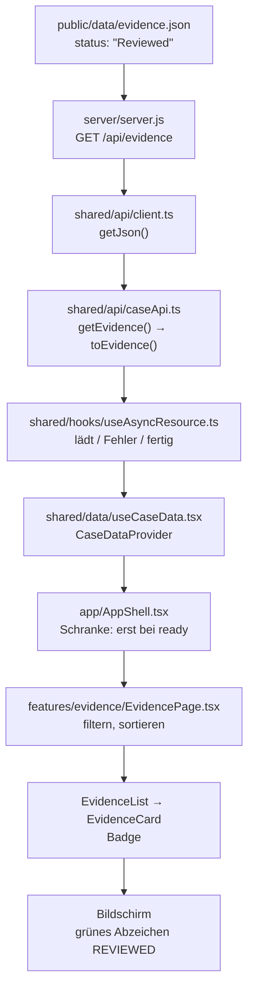

# Datenfluss von der Datei bis auf den Bildschirm

Exercise 6, Demo 10. Verfolgt wird **ein** Beweisstück: `E12 — Approved release
manifest`. Es ist das einzige der 18, dessen Rohdaten `"status": "Reviewed"`
groß geschrieben haben — dadurch wird jeder Schritt an einem konkreten Wert
sichtbar, nicht nur an einem Pfeil.

## Der Weg



## Was an jedem Schritt mit E12 passiert

| #   | Ort                                  | was dort geschieht                                                                                    | Wert danach                           |
| --- | ------------------------------------ | ----------------------------------------------------------------------------------------------------- | ------------------------------------- |
| 1   | `public/data/evidence.json`          | liegt als Datei auf der Platte                                                                        | `"status": "Reviewed"`                |
| 2   | `server/server.js`                   | liest die Datei und gibt sie unverändert aus; kann auf Abruf verzögern, scheitern oder leer antworten | unverändert, HTTP 200                 |
| 3   | `shared/api/client.ts`               | `fetch`, Statusprüfung, `HttpError` bei allem, was nicht 2xx ist                                      | `RawEvidence[]`                       |
| 4   | `shared/api/caseApi.ts`              | `toEvidence()` normalisiert die Schreibweise auf die Union-Typen                                      | `status: "reviewed"`                  |
| 5   | `shared/hooks/useAsyncResource.ts`   | macht daraus einen Zustand: `loading` → `ready`, Abbruch per `AbortController`                        | `{ status: "ready", data }`           |
| 6   | `shared/data/useCaseData.tsx`        | führt die fünf Ressourcen zu einem Zustand zusammen, legt ihn in den Context                          | `CaseDataPayload`                     |
| 7   | `app/AppShell.tsx`                   | zeigt Ladeanzeige oder Fehler; rendert das `<Outlet />` erst bei `ready`                              | Seite wird überhaupt erst gerendert   |
| 8   | `features/evidence/EvidencePage.tsx` | filtert und sortiert, abgeleitet aus `evidence` + `filters`                                           | E12 ist in `visibleEvidence`          |
| 9   | `EvidenceCard` + `Badge`             | `toneForStatus("reviewed")` → `badge-reviewed`                                                        | `<span class="badge badge-reviewed">` |
| 10  | Bildschirm                           |                                                                                                       | grünes Abzeichen **REVIEWED**         |

Nachgemessen im Browser:

```
E12 Badges  : CRITICAL | REVIEWED | UNKNOWN
E12 Klassen : badge badge-critical , badge badge-reviewed , badge badge-unreviewed
Filter "reviewed" → 1 von 18 Beweisstücken, darunter E12
```

## Was passiert, wenn ein Schritt still ausfällt

| Schritt fällt aus                              | Symptom auf dem Bildschirm                                                                                                                                                                                             | woran man es merkt                                                    |
| ---------------------------------------------- | ---------------------------------------------------------------------------------------------------------------------------------------------------------------------------------------------------------------------- | --------------------------------------------------------------------- |
| **2 — Backend läuft nicht**                    | roter Kasten „Die Fallakte konnte nicht geladen werden", Meldung `/api/case: HTTP 502 Bad Gateway`; im Fußbereich roter Punkt                                                                                          | sofort, die Anwendung sagt es selbst                                  |
| **3 — Statusprüfung fehlt**                    | ein 500er Fehlertext wird als Daten geparst; `evidence.map` wirft oder die Liste ist leer, ohne Fehlermeldung                                                                                                          | gefährlich: sieht aus wie „keine Daten", ist aber ein Serverfehler    |
| **4 — `toEvidence()` fehlt**                   | E12 behält `"Reviewed"`. Das Abzeichen heißt weiterhin REVIEWED, ist aber **grau** statt grün (`toneForStatus` fällt auf `unreviewed` zurück), und der Filter „reviewed" findet E12 **nicht mehr** — 0 statt 1 Treffer | der leiseste Ausfall von allen: ein Grauton und ein fehlender Treffer |
| **5 — `setState` im `catch` fehlt**            | Ladeanzeige bleibt für immer stehen, aber nur im Fehlerfall                                                                                                                                                            | der klassische „hängende Spinner" aus Exercise 1                      |
| **5 — `abort()` in der Aufräumfunktion fehlt** | veraltete Antworten können neuere überschreiben (Demo 7), im Entwicklungsmodus doppelt so viele Anfragen                                                                                                               | nur mit künstlicher Verzögerung sichtbar                              |
| **7 — Schranke in AppShell fehlt**             | `useCaseData()` wirft, weil die Daten noch nicht da sind                                                                                                                                                               | laut und sofort — mit Absicht so gebaut                               |

Der lehrreichste Fall ist **Schritt 4**: Der einzige Hinweis ist eine Farbe und
ein Filter, der einen Treffer weniger liefert. Genau deshalb steht die
Normalisierung in der Zugriffsschicht und nicht in der Komponente — dort wäre
sie leicht zu vergessen, und zwar pro Komponente einmal.

## Eine UX-Entscheidung, ehrlich begründet

**Entscheidung: Lade- und Fehlerzustand liegen in `AppShell`, der Leerzustand
in der Ansicht.**

Alle fünf Ansichten lesen dieselben Falldaten aus demselben Provider. Wären
Ladeanzeige und Fehlermeldung in den Seiten, stünden sie fünfmal da und
könnten fünfmal unterschiedlich aussehen. In `AppShell` stehen sie einmal.
Kopf- und Fußbereich bleiben dabei stehen, die Navigation ist also auch im
Fehlerfall bedienbar — und der Fehler nennt die technische Ursache
(`/api/case: HTTP 500 Internal Server Error`) statt eines allgemeinen Satzes,
weil die Zielgruppe hier Entwickler und Prüfer sind.

Die Leerzustände gehören dagegen in die Ansicht, weil „leer" je nach Ansicht
etwas anderes heißt. In der Evidence-Ansicht gibt es sogar **zwei**:

|                | Lage                                                 | was der Benutzer tun kann               |
| -------------- | ---------------------------------------------------- | --------------------------------------- |
| `hasNoData`    | Server antwortete erfolgreich, die Fallakte ist leer | nichts                                  |
| `hasNoMatches` | es gibt Beweisstücke, aber kein Filter passt         | Filter zurücksetzen (Knopf steht dabei) |

Dass die drei Zustände verschiedene Hintergrundfarben **und** verschiedene
ARIA-Rollen haben (`status`, `alert`, `status`), ist bewusst: für sehende
Benutzer die Farbe, für Screenreader die Rolle. Vorher waren alle drei ein
`<p class="stub-note">`.

**Was ich mit mehr Zeit anders machen würde**

Die Ladeanzeige erscheint sofort. Bei einem Backend, das in 80 ms antwortet,
blitzt sie kurz auf und verschwindet wieder — das wirkt unruhiger, als gar
nichts zu zeigen. Richtig wäre eine Verzögerung von etwa 200 ms, bevor der
Spinner überhaupt erscheint, und danach eine Mindestanzeigedauer, damit er
nicht mitten in der Drehung verschwindet. Beides ist mit dem vorhandenen
Zustand leicht nachzurüsten, war aber für die Demos nicht nötig — im
Gegenteil, für das Vorführen ist der sofort sichtbare Spinner nützlicher.

## Was der Wechsel zum echten Server erzwungen hat

| hinzugekommen                    | war es vorher schon nötig?                                                                                                                                        |
| -------------------------------- | ----------------------------------------------------------------------------------------------------------------------------------------------------------------- |
| Ladezustand                      | **ja, nur unsichtbar.** Eine Datei kam in Millisekunden, der Zustand existierte trotzdem.                                                                         |
| Fehlerzustand                    | **ja.** Eine fehlende Datei war ein 404 — behandelt wurde er nur nicht.                                                                                           |
| Leerzustand                      | **ja.** Eine leere Liste war immer möglich, sie kam nur nie vor.                                                                                                  |
| Abbruch (`AbortController`)      | **begrifflich ja.** Schon in Exercise 5 lief beim Seitenwechsel eine Anfrage weiter, deren Ergebnis niemand mehr wollte. Bei 2 ms Antwortzeit fiel das nicht auf. |
| Unterscheidung „lädt" vs. „leer" | **ja.** Mit `evidence: []` neben `status: "loading"` war der Unterschied von Anfang an nicht ausdrückbar.                                                         |

Nichts davon ist durch das Backend neu entstanden. Das Backend hat nur
**sichtbar gemacht**, was vorher schon fehlte — weil eine statische Datei
weder langsam ist noch scheitert noch leer antwortet.
